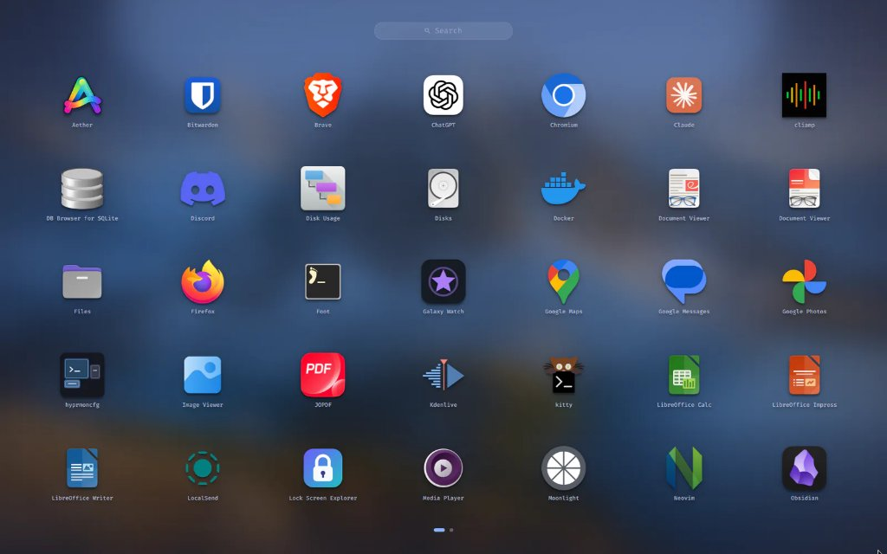

# Savanna for Windows 🪟🌿

A seamless, macOS Launchpad & GNOME-style native application launcher for Windows, inspired by [Savanna for Omarchy](https://github.com/XNinety9/savanna).

Built with **100% native Rust**, running as a background notification tray daemon with global hotkey support, real desktop wallpaper frosted blur, and precision trackpad gestures.



---

## ✨ Features

- **Seamless Native Desktop Overlay (Not an app window!)**:
  - **Runs in System Notification Tray**: Sits unobtrusively in the tray area (near the clock) with a right-click menu (Open, Edit Config, Reload Apps, Exit).
  - **No Taskbar Icon**: Does not pollute your Windows taskbar (`with_taskbar(false)`).
  - **Global Hotkey Daemon (`Alt + Space`)**: Press `Alt + Space` anytime to summon or dismiss Savanna instantly in 0 milliseconds.
  - **Escape & Click Dismiss**: Pressing <kbd>Esc</kbd> or clicking outside smoothly hides the launcher and returns focus to your previous window.
- **Authentic macOS-Style Frosted Wallpaper Blur**:
  - Reads your active Windows desktop wallpaper (`TranscodedWallpaper`).
  - Renders a hardware-accelerated 2-pass frosted blur with a deep translucent acrylic vignette.
  - The blurred wallpaper smoothly fades in behind your icons just like macOS Launchpad.
- **Screen-Filling Grid & High-Res Auto-Scaled Icons**:
  - Grid expands to 92% of your display width (up to 1800px on widescreen/ultrawide displays).
  - **High-Res 256×256 Shell Extraction**: Extracts jumbo vector/PNG assets from Windows Shell COM.
  - **Smart Border Trimming & Normalization**: Automatically detects transparent padding on UWP apps (*Calculator, Camera, Dev Home, Clock*) and scales the graphics up with Lanczos3 resampling to uniformly fill the icon slot.
  - Text drop shadows for razor-sharp legibility over any wallpaper.
- **Alfred-Style Fuzzy Search**:
  - Refined translucent frosted glass pill with subtle border and focus accent glow (no solid white block).
  - Matches word prefixes (`fi` → Files, Firefox) and acronyms/initials (`vsc` → Visual Studio Code, `cmd` → Command Prompt).
  - Live blinking caret cursor and app count badge.
- **Trackpad, Gesture & Mouse Navigation**:
  - **Trackpad Gestures**: 2-finger horizontal swipe smoothly flips pages.
  - **Drag Gesture**: Click and drag horizontally with mouse or touch to flick between pages.
  - **Mouse Wheel & Pagination Pills**: Click the animated bottom pills or scroll the wheel to jump pages.
- **Clutter-Free App Scanner**:
  - Automatically filters out diagnostic/system clutter (`Administrative Tools`, `dfrgui`, `Event Viewer`, `Local Security Policy`, `Computer Management`, duplicate private browsing entries).

---

## 🚀 How to Run & Test

1. If an older build is currently running, exit it via Task Manager or close its window.
2. Launch the new release executable:
   ```powershell
   & "d:\Projects\App overview\target\release\savanna-win.exe"
   ```
3. Press **`Alt + Space`** anytime to summon or dismiss Savanna!
4. Check your Windows Notification Tray (bottom right near the clock) for the 🌿 **Savanna** icon.

---

## ⌨️ Shortcuts & Gestures

| Action / Gesture | What it does |
|---|---|
| **Alt + Space** | Global hotkey to summon / dismiss Savanna anytime |
| **Tray Icon Click** | Left-click or double-click tray icon to toggle |
| **Right-Click Tray Icon** | Open context menu (Open, Edit Config, Reload, Exit) |
| **Type any letters** | Search instantly with Alfred-style fuzzy matching |
| **Arrow Keys** | Move selection (rolls over across pages at grid boundaries) |
| **Enter** | Launch selected app and smoothly hide launcher |
| **Escape** | Clear search query or dismiss launcher |
| **Trackpad 2-Finger Swipe** | Swipe horizontally between pages |
| **Mouse / Touch Drag** | Drag left/right to flick between pages |
| **Page Up / Page Down** | Jump to previous / next page |

---

## ⚙️ Configuration (`%APPDATA%\Savanna\config.toml`)

```toml
columns = 7
rows = 5
icon_size = 80.0
show_labels = true
backdrop = "Wallpaper"    # "Wallpaper", "Centered"
centered = false          # true for floating card, false for full Launchpad
accent_color = "#89b4fa"  # Catppuccin Blue (#89b4fa), Lavender (#cba6f7), Mint (#a6e3a1)
hotkey = "Alt+Space"
```
