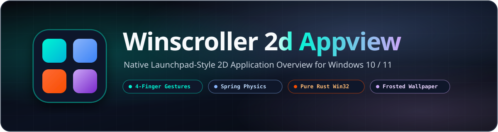
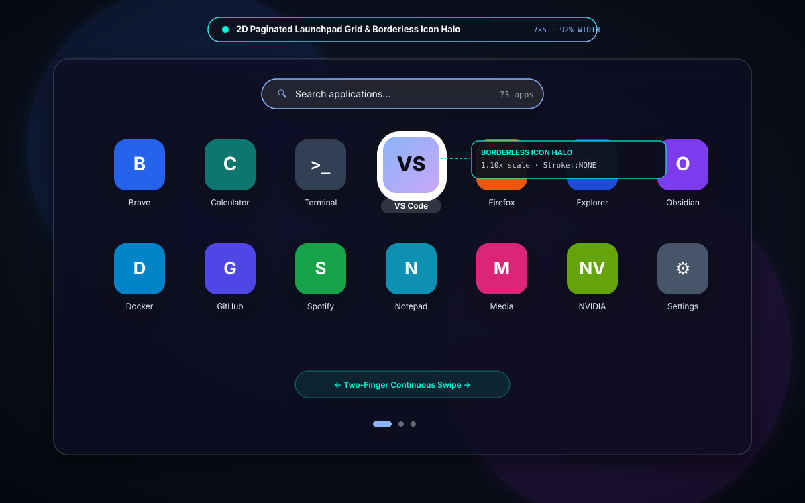
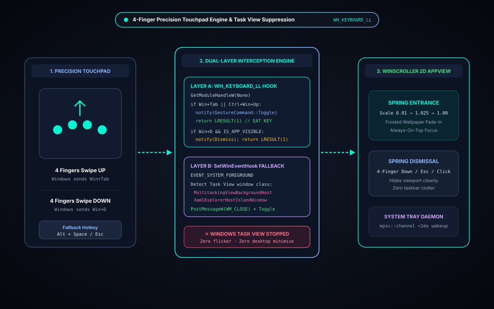
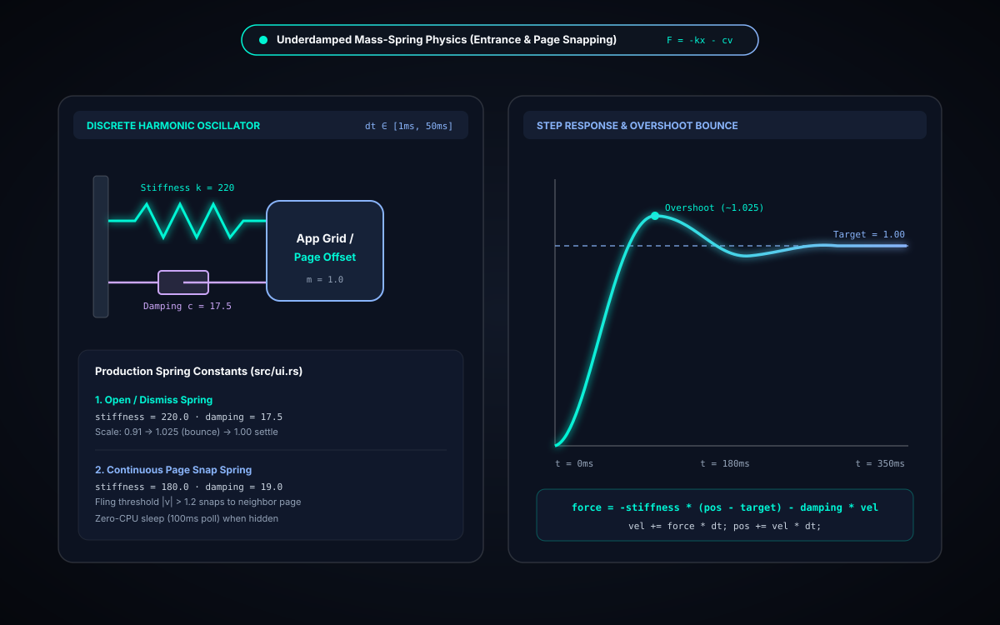
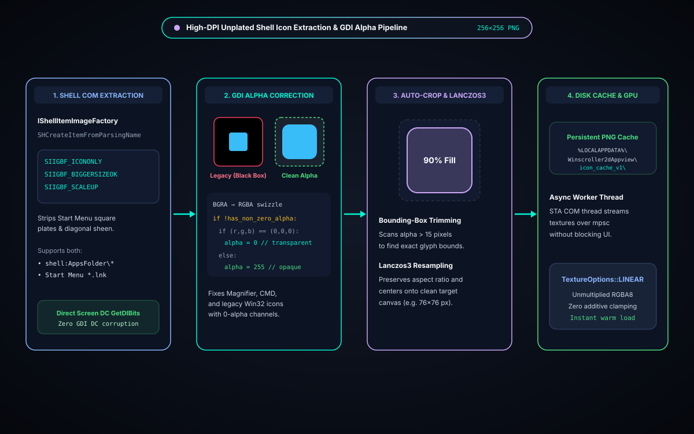
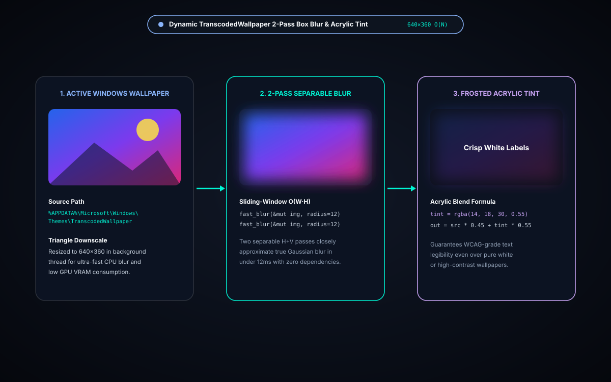
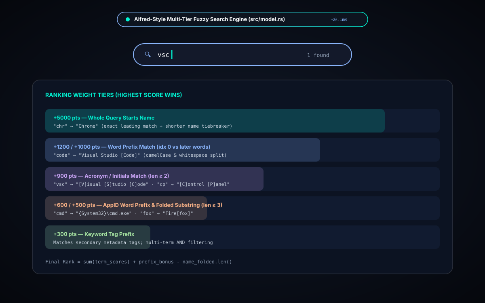

<p align="center">
  
</p>

# Winscroller 2d Appview

**A native fullscreen & floating Launchpad-style 2D application overview for Windows 10/11 — featuring 4-finger Precision Touchpad gestures (with automatic Windows Task View interception), continuous 2-finger page swiping, underdamped spring physics, borderless icon halos, and frosted wallpaper acrylic blur in pure Rust.**


[](https://github.com/fruitsaladwindowsai-zammy/App-overview/actions/workflows/ci.yml)
[](https://fruitsaladwindowsai-zammy.github.io/App-overview/)


> 📖 **Official Documentation & Direct Download**:  
> - ⬇️ [**Download Latest `winscroller-2d-appview.exe`**](https://github.com/fruitsaladwindowsai-zammy/App-overview/releases/latest/download/winscroller-2d-appview.exe) *(automatically updated on every push — auto-checks & installs runtime prerequisites on launch)*  
> - 📚 Read the full mdBook manual at [**fruitsaladwindowsai-zammy.github.io/App-overview**](https://fruitsaladwindowsai-zammy.github.io/App-overview/) or browse the [GitHub Wiki](wiki/Home.md).

```text
  ┌───────────────────────── Winscroller 2d Appview ─────────────────────────┐
  │                                                                          │
  │                    [ 🔍 Search applications...     73 apps ]             │
  │                                                                          │
  │     [App]     [App]     [App]     ( ★ VS Code )     [App]     [App]     │
  │     Brave     Calc      Term       1.10x Halo       Edge     Obsidian    │
  │                                                                          │
  │     [App]     [App]     [App]        [App]          [App]     [App]     │
  │     Docker    GitHub    Spotify      Notepad        Media     Settings   │
  │                                                                          │
  │              ◄── 2-Finger Continuous Swipe & Spring Snap ──►             │
  │                                  ( ━━━  ○  ○ )                           │
  └──────────────────────────────────────────────────────────────────────────┘
```

---

## Visual Overview & Architectural Concepts

### Architectural Concepts & System Mechanics

| 2D Launchpad Grid & Borderless Icon Halo | 4-Finger Gestures & Task View Suppression |
|:---:|:---:|
|  |  |
| *Screen-filling 7×5 grid, 1.10x scale & borderless ambient halo* | *Dual-layer `WH_KEYBOARD_LL` + `SetWinEventHook` replaces Task View* |

| Underdamped Mass-Spring Physics ($F = -kx - cv$) | High-DPI Unplated Shell Icon Pipeline |
|:---:|:---:|
|  |  |
| *Snappy entrance bounce (`0.91 → 1.025 → 1.00`) & fling page snap* | *`SIIGBF_ICONONLY`, GDI 0-alpha fix, auto-crop & Lanczos3 caching* |

| Dynamic `TranscodedWallpaper` 2-Pass Blur | Alfred-Style Multi-Tier Fuzzy Search |
|:---:|:---:|
|  |  |
| *Fast $O(W \cdot H)$ separable box blur + dark frosted acrylic tint* | *Prefix, camelCase initials (`vsc`), AppID & substring ranking* |

---

## Core Features

- **Seamless Native System Tray Overlay (Zero Taskbar Clutter)**:
  - Runs unobtrusively in the Windows notification tray (`Shell_NotifyIconW`) with no taskbar button (`with_taskbar(false)`).
  - Right-click context menu for **Open**, **Edit Configuration**, **Reload Installed Apps**, and **Exit**.
- **Native 4-Finger Touchpad Gestures (Stops Windows Task View)**:
  - **4-Finger Swipe Up**: Dual-layer interception (`WH_KEYBOARD_LL` with valid `GetModuleHandleW` + `SetWinEventHook` Task View monitor) suppresses Windows Task View and opens **Winscroller 2d Appview** in under 1 millisecond.
  - **4-Finger Swipe Down / <kbd>Esc</kbd>**: Suppresses desktop minimization when open and plays the smooth spring dismissal animation.
  - **Fallback Hotkey**: <kbd>Alt</kbd> + <kbd>Space</kbd> registered globally via `RegisterHotKey`.
- **Continuous Two-Finger Page Swiping & Fling Momentum**:
  - Tracks fractional `page_offset: f32` during two-finger horizontal trackpad scrolls or pointer drags.
  - Adjacent pages slide seamlessly across the display with distance-based alpha fade, velocity fling detection, and spring-damper snapping.
  - Morphing pagination indicator pills interpolate width and color in real time.
- **Borderless Icon Selection Highlight**:
  - Zero stroke borders or giant tile boxes.
  - Hovered/selected icons gently scale up **1.10x** with a soft, borderless translucent squircle wash strictly behind the icon glyph and a subtle label pill.
- **Crystal-Clear Unplated Icons & Dynamic Wallpaper Blur**:
  - Extracts unplated 256×256 icons via `IShellItemImageFactory` (`SIIGBF_ICONONLY | SIIGBF_BIGGERSIZEOK | SIIGBF_SCALEUP`), repairs legacy GDI 0-alpha black backgrounds, crops empty margins, and caches Lanczos3-scaled PNGs to `%LOCALAPPDATA%\Winscroller2dAppview\icon_cache_v1\`.
  - Automatically loads `%APPDATA%\Microsoft\Windows\Themes\TranscodedWallpaper` and applies a 2-pass box blur + dark acrylic tint (`rgba(14, 18, 30, 0.55)`).
- **Clutter-Free App Scanner & Alfred-Style Search**:
  - Scans both UWP/MSIX packages (`Get-StartApps`) and Start Menu `.lnk` shortcuts while filtering out administrative clutter (`dfrgui`, `Event Viewer`, `Computer Management`, uninstallers, private browsing duplicates).

---

## Installation Guide (Step-by-Step)

### 1. Prerequisites (Clean Windows 10 / 11 Machine)
Windows does **not** include Git or Rust by default. On a fresh PC, open an **Administrator PowerShell** prompt and run:

```powershell
# 1. Install Git for Windows
winget install --id Git.Git --accept-package-agreements --accept-source-agreements

# 2. Install Rust toolchain (Rustup)
winget install --id Rustlang.Rustup --accept-package-agreements --accept-source-agreements

# 3. Install MSVC C++ Build Tools (or LLVM-MinGW for GNU target)
winget install --id Microsoft.VisualStudio.2022.BuildTools --override "--wait --quiet --add Microsoft.VisualStudio.Workload.VCTools --includeRecommended"
```

> [!IMPORTANT]
> **Restart Your Terminal**: After running the `winget` commands above, close and reopen PowerShell so `git`, `cargo`, and `rustc` are active on your `PATH`.

### 2. Clone the Repository
```powershell
git clone https://github.com/fruitsaladwindowsai-zammy/App-overview.git
cd "App-overview"
```

### 3. Build & Run the Release Binary
```powershell
cargo build --release
& ".\target\release\winscroller-2d-appview.exe"
```

### 4. Auto-Start with Windows (Optional)
Run this one-liner in PowerShell to add **Winscroller 2d Appview** to your Windows Startup folder:
```powershell
$WshShell = New-Object -ComObject WScript.Shell
$Shortcut = $WshShell.CreateShortcut("$env:APPDATA\Microsoft\Windows\Start Menu\Programs\Startup\Winscroller2dAppview.lnk")
$Shortcut.TargetPath = (Resolve-Path ".\target\release\winscroller-2d-appview.exe").Path
$Shortcut.WorkingDirectory = (Resolve-Path ".\target\release").Path
$Shortcut.Save()
```

---

## Controls & Gestures Quick Reference

| Action | Gesture / Shortcut |
|---|---|
| **Summon Overview** | **4-Finger Swipe Up** (stops Task View) or <kbd>Alt</kbd> + <kbd>Space</kbd> or **Click Tray Icon** |
| **Dismiss Overview** | **4-Finger Swipe Down** or <kbd>Esc</kbd> or **Drag Down** or **Click Wallpaper** |
| **Slide Between Pages** | **2-Finger Horizontal Swipe** or **Mouse Wheel / Pointer Drag** |
| **Jump to Page** | **Click Bottom Pagination Pill** or <kbd>PageUp</kbd> / <kbd>PageDown</kbd> |
| **Fuzzy Search** | **Start typing anywhere** (e.g. `vsc`, `cmd`, `chr`) |
| **Grid Navigation** | <kbd>←</kbd> <kbd>→</kbd> <kbd>↑</kbd> <kbd>↓</kbd> (auto-rolls over pages) |
| **Launch App** | <kbd>Enter</kbd> or **Left-Click Icon** |

See [KEYBINDINGS.md](KEYBINDINGS.md) and [USAGE.md](USAGE.md) for the complete control guide.

---

## Configuration (`%APPDATA%\Winscroller2dAppview\config.toml`)

Copy [winscroller-2d-appview.example.toml](winscroller-2d-appview.example.toml) or right-click the tray icon → **Edit Configuration**:

```toml
columns = 7
rows = 5
icon_size = 76.0
show_labels = true
backdrop = "Wallpaper"    # "Wallpaper" or "Centered"
centered = false          # false = Fullscreen Launchpad, true = Floating Glass Card
card_width = 0.75
card_height = 0.80
glow = true
accent_color = "#89b4fa"  # Catppuccin Blue (#89b4fa), Cyan (#00f5d4), Lavender (#cba6f7)
hotkey = "Alt+Space"
```

See [CONFIGURATION.md](CONFIGURATION.md) for full options and profiles.

---

## CLI Options

```powershell
winscroller-2d-appview.exe --version           # Print version and exit
winscroller-2d-appview.exe --help              # Print usage and flags
winscroller-2d-appview.exe --init-config       # Generate default config.toml
winscroller-2d-appview.exe --validate          # Validate config.toml and exit
winscroller-2d-appview.exe --check-prereqs     # Verify & auto-install runtime prerequisites
winscroller-2d-appview.exe --install-autostart # Enable automatic startup at Windows logon
winscroller-2d-appview.exe --remove-autostart  # Disable automatic startup at Windows logon
winscroller-2d-appview.exe --config <PATH>     # Load custom config.toml
```

---

## Documentation & Project Files

- [USAGE.md](USAGE.md) — Daily workflows, gesture tips, and tray daemon guide
- [KEYBINDINGS.md](KEYBINDINGS.md) — Complete shortcut, gesture, and mouse reference
- [CONFIGURATION.md](CONFIGURATION.md) — Full `config.toml` schema & presets
- [CHANGELOG.md](CHANGELOG.md) — Version history
- [RELEASE_NOTES.md](RELEASE_NOTES.md) — v0.1.0 release highlights
- [CONTRIBUTING.md](CONTRIBUTING.md) — Development setup, testing & PR checklist
- [SECURITY.md](SECURITY.md) — Hook & privacy model, vulnerability reporting
- [docs/](docs/README.md) — mdBook documentation site source
- [wiki/](wiki/Home.md) — GitHub Wiki pages & sidebar
- `website/serve.ps1` — Local interactive showcase website & Live Launchpad Simulator

---

## License

Licensed under the [MIT License](LICENSE).
