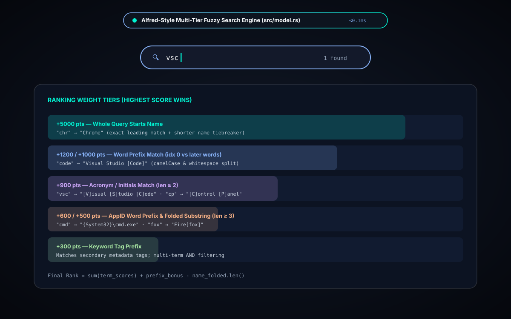

# Alfred-Style Fuzzy Search

`src/model.rs` implements a deterministic, allocation-light, multi-tier fuzzy scoring engine inspired by Alfred and Savanna.

## Tokenization & Normalization
- `fold(text)`: Lowercases and strips punctuation while preserving alphanumeric characters and spaces.
- `words(text)`: Splits on whitespace, punctuation, and **camelCase boundaries** (e.g., `WinScroller2D` → `["win", "scroller2d"]`).
- `initials`: Collects the first letter of every word (e.g., `Visual Studio Code` → `"vsc"`).

## Multi-Term Ranking Tiers
Every whitespace-separated term in the query must match (AND semantics). Each term receives the highest applicable tier score:

| Tier | Score | Match Condition | Example |
|---|---|---|---|
| **Leading Name Bonus** | `+5000` | Full folded query starts the app name | `"chr"` → `Chrome` |
| **First Word Prefix** | `+1200` | Term starts word 0 of app name | `"fire"` → `Firefox` |
| **Later Word Prefix** | `+1000` | Term starts word 1+ of app name | `"code"` → `Visual Studio Code` |
| **Acronym / Initials** | `+900` | `term.len() >= 2` and starts `initials` | `"vsc"` → `Visual Studio Code` |
| **AppID Word Prefix** | `+600` | Term starts a word in the target AppID | `"cmd"` → `System32\cmd.exe` |
| **Folded Substring** | `+500` | `term.len() >= 3` contained in name | `"fox"` → `Firefox` |
| **Keyword Tag Prefix** | `+300` | Term starts any keyword tag word | Metadata tags |

Finally, `score - name_folded.len()` breaks ties in favor of shorter, more exact application names.
