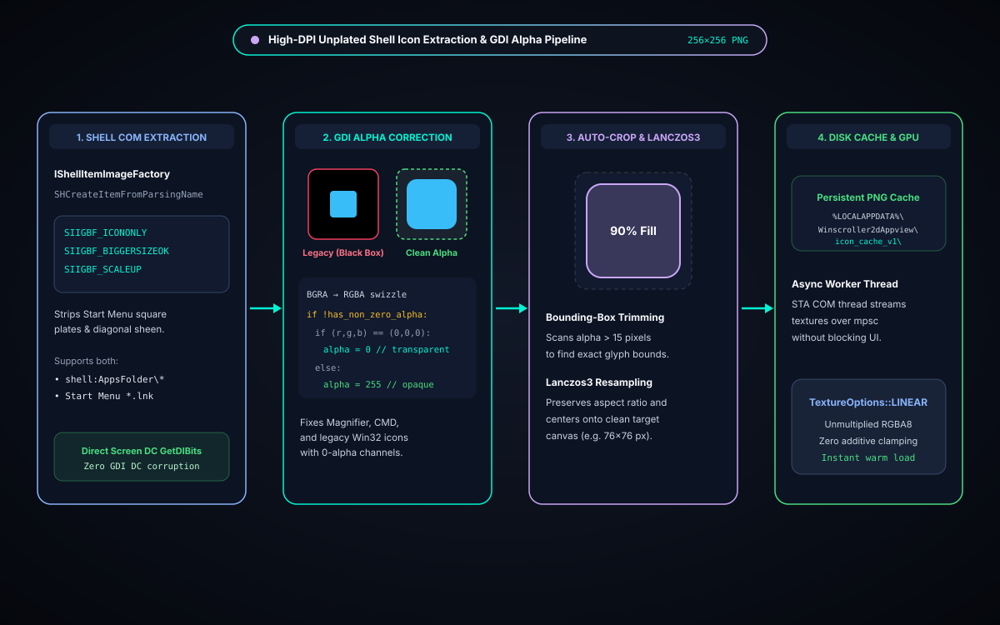
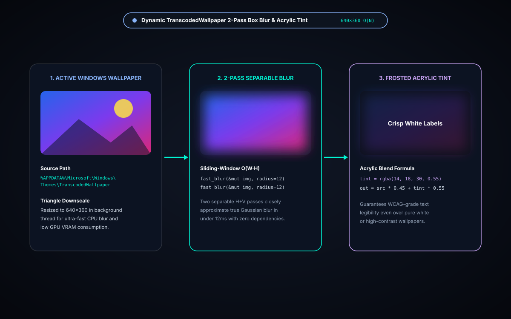

# Unplated Icons & Frosted Wallpaper Blur

## High-DPI Unplated Shell Icon Pipeline

`src/icon_extractor.rs` solves the two classic Windows icon rendering artifacts (Start Menu plated tiles and solid black legacy Win32 boxes):

1. **Unplated Shell COM Extraction**: Calls `SHCreateItemFromParsingName` and `IShellItemImageFactory::GetImage` at `256×256` with `SIIGBF_ICONONLY | SIIGBF_BIGGERSIZEOK | SIIGBF_SCALEUP`.
2. **Safe GDI Readback**: Passes the screen DC directly to `GetDIBits` without selecting the `HBITMAP` into a memory DC, preventing GDI corruption.
3. **0-Alpha Legacy Repair**: Swizzles BGRA → RGBA. If every pixel has `alpha == 0` (classic Win32 24-bit/32-bit RGB bitmaps like `cmd.exe` and `magnify.exe`), pure black `(0, 0, 0)` pixels stay transparent (`alpha = 0`) while colored content pixels become opaque (`alpha = 255`).
4. **Bounding-Box Auto-Crop & Lanczos3 Normalization**: Scans `alpha > 15` bounds, trims excessive transparent margins, scales the graphic with `FilterType::Lanczos3` to fill **90%** of the target canvas, and caches the resulting PNG in `%LOCALAPPDATA%\Winscroller2dAppview\icon_cache_v1\`.

---

## Dynamic `TranscodedWallpaper` 2-Pass Blur

`src/wallpaper.rs` runs on a background thread at startup:
1. Reads `%APPDATA%\Microsoft\Windows\Themes\TranscodedWallpaper`.
2. Downscales to `640×360` with triangle filtering.
3. Runs two passes of an $O(W \cdot H)$ separable sliding-window box blur (`radius = 12`) to produce a smooth Gaussian-like frosted glass backdrop.
4. Blends a dark acrylic tint (`rgba(14, 18, 30, 0.55)`) so white icons and labels stay sharp over any light or colorful wallpaper.
