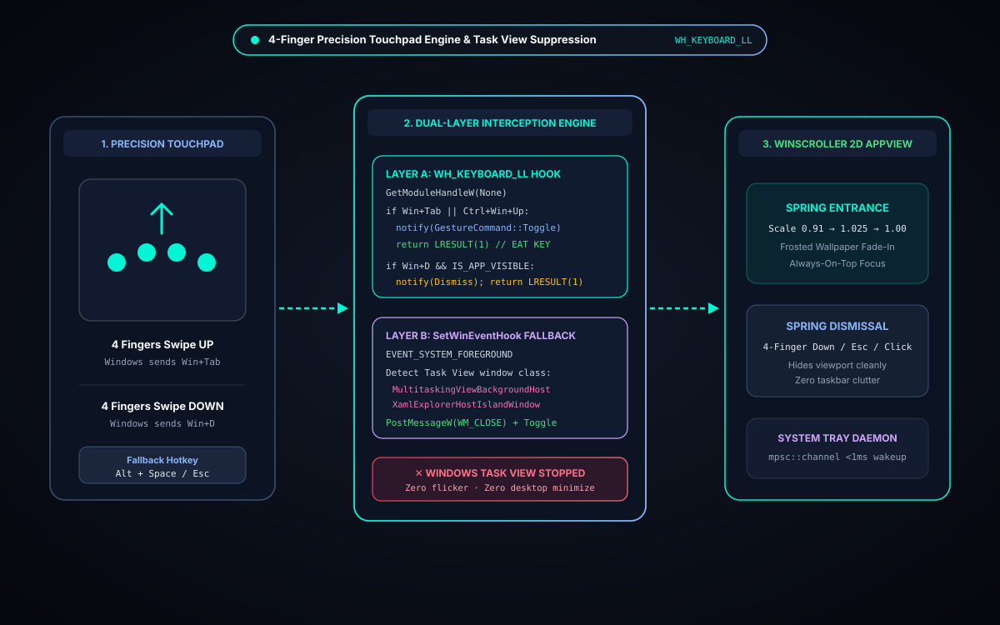

# Touchpad Gestures & Task View Suppression

**Winscroller 2d Appview** is engineered from the ground up for laptops with **Windows Precision Touchpads** (e.g., Dell, ThinkPad, Surface, XPS, MacBook Boot Camp).

## How 4-Finger Swipe Up Stops Windows Task View

On Windows 10/11, swiping 4 fingers up activates **Windows Task View** (Virtual Desktops / App View). To replace it cleanly without modifying system files, `src/hotkey.rs` uses a **dual-layer interception engine**:

### Layer A — `WH_KEYBOARD_LL` Low-Level Keyboard Hook
- Installed with a valid executable module handle via `GetModuleHandleW(PCWSTR::null())`.
- Intercepts `Win + Tab` and `Ctrl + Win + Up` synthesized by Precision Touchpad drivers.
- Sends `GestureCommand::Toggle` to the UI channel and returns `LRESULT(1)` so Windows never sees the key sequence.

### Layer B — `SetWinEventHook` Foreground Window Monitor
- Listens out-of-context (`WINEVENT_OUTOFCONTEXT`) to `EVENT_SYSTEM_FOREGROUND` and `EVENT_OBJECT_SHOW`.
- If a vendor driver or DWM opens Task View directly (`MultitaskingViewBackgroundHost` or `XamlExplorerHostIslandWindow`), Winscroller immediately closes it (`PostMessageW(WM_CLOSE)` + synthetic `VK_ESCAPE`) and brings Winscroller 2d Appview to the foreground.

## How 4-Finger Swipe Down Works

- Intercepts `Win + D` and `Ctrl + Win + Down`.
- Checks the atomic `IS_APP_VISIBLE` flag:
  - **When Winscroller is open**: triggers `GestureCommand::Dismiss` and returns `LRESULT(1)` so your open windows are not minimized to the desktop.
  - **When Winscroller is hidden**: passes through untouched via `CallNextHookEx` so normal Show Desktop works as usual.

## Two-Finger Continuous Page Swiping

Inside the overlay, horizontal trackpad scrolling (`egui::Event::MouseWheel` `delta.x` and `smooth_scroll_delta.x`) and pointer dragging continuously drive `page_offset: f32`. Releasing after a fast flick (`|page_velocity| > 1.2`) flings cleanly to the adjacent page with spring-damper deceleration.
