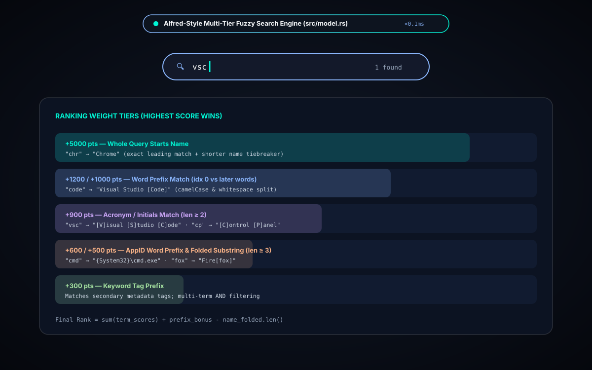

# Core Concepts

## 1. Seamless Tray Daemon (Not an App Window)
Winscroller 2d Appview runs with `with_taskbar(false)` and `with_always_on_top()`. It stays invisible in the notification tray until summoned, consuming minimal memory and zero taskbar real estate.

## 2. Borderless Icon Selection Halo
Instead of heavy rectangular boxes or borders around focused tiles, Winscroller 2d Appview highlights the active icon with:
- Smooth **1.10x** icon scaling.
- A soft, **borderless** frosted squircle halo (`painter.rect_filled`) strictly behind the icon graphic.
- A subtle translucent pill behind the selected app's label text.

## 3. Continuous 2D Pagination
Applications are distributed across `columns × rows` pages (default `7 × 5 = 35` apps/page). During two-finger horizontal swipes or pointer drags, multiple adjacent pages render simultaneously at fractional horizontal offsets (`page_offset: f32`) with distance-based alpha fading.

## 4. Alfred-Style Multi-Tier Fuzzy Search

Typing immediately filters your installed apps using exact leading prefix (`+5000`), word prefix (`+1200`/`+1000`), camelCase initials (`+900`, e.g., `vsc` → Visual Studio Code), AppID prefix (`+600`), substring (`+500`), and keyword tags (`+300`).
