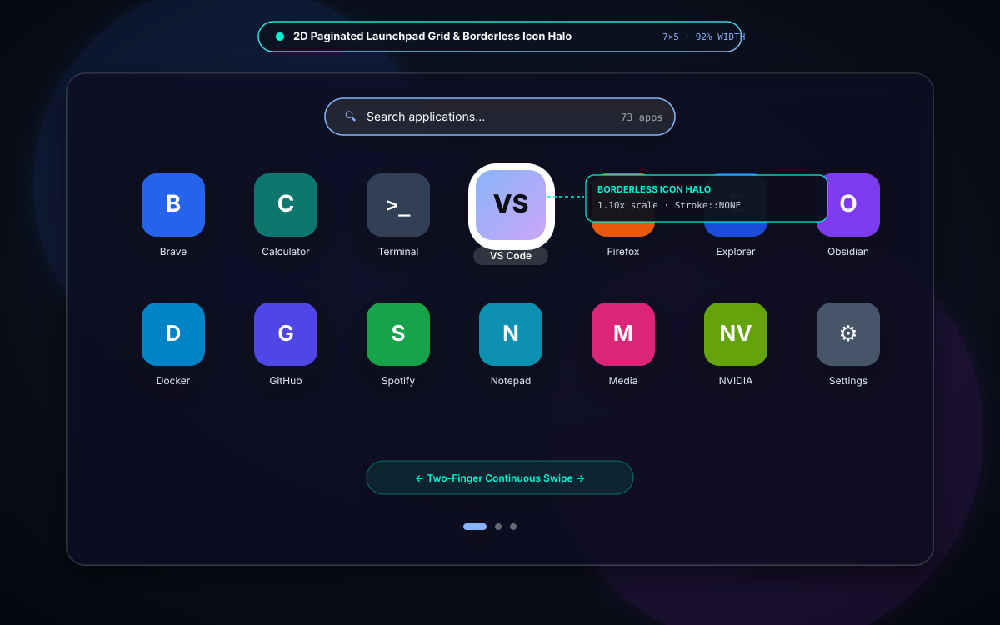

# Welcome to the Winscroller 2d Appview Wiki

**Winscroller 2d Appview** is a native Rust fullscreen & floating Launchpad-style 2D application overview for Windows 10 and Windows 11.

## Quick Navigation

- **[Getting Started](Getting-Started)** — Prerequisites, compiling from source, and Windows autostart.
- **[Core Concepts](Core-Concepts)** — Borderless icon halos, continuous 2D pagination, and Alfred-style fuzzy search.
- **[Touchpad Gestures](Touchpad-Gestures)** — 4-finger swipe up/down, Windows Task View suppression, and 2-finger continuous scrolling.
- **[Keyboard Shortcuts](Keyboard-Shortcuts)** — Complete keyboard, mouse, and system tray control reference.
- **[Spring Physics & Animations](Spring-Physics-and-Animations)** — Damped harmonic oscillator math and tuning parameters.
- **[Icon Extraction & Wallpaper Blur](Icon-Extraction-and-Wallpaper-Blur)** — Unplated 256×256 Shell COM extraction, GDI 0-alpha repair, and 2-pass `TranscodedWallpaper` blur.
- **[Configuration Guide](Configuration-Guide)** — Full `config.toml` reference and ready-to-use display profiles.
- **[Architecture & Internals](Architecture-and-Internals)** — Multi-threaded actor channels, hooks, and Win32 subsystem design.
- **[Troubleshooting & FAQ](Troubleshooting-and-FAQ)** — Solutions for elevated windows, icon cache refreshes, and touchpad settings.
