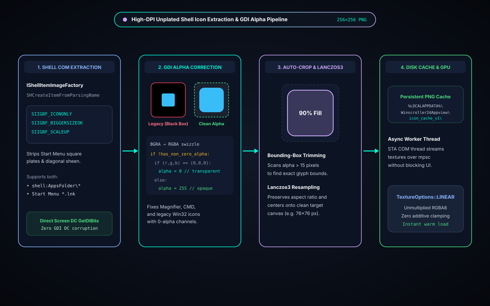
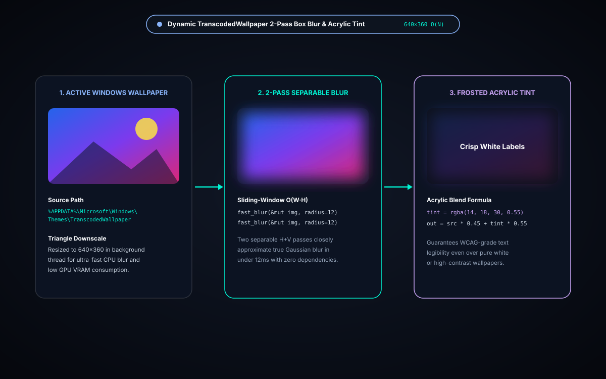

# Icon Extraction & Wallpaper Blur

## Unplated High-DPI Shell Icons

- Queries `IShellItemImageFactory::GetImage` at `256×256` with `SIIGBF_ICONONLY | SIIGBF_BIGGERSIZEOK | SIIGBF_SCALEUP`.
- Extracts pixels via direct screen DC `GetDIBits` (avoiding memory DC corruption).
- Repairs 0-alpha legacy Win32 icons (`cmd.exe`, `magnify.exe`) by keeping pure black `(0,0,0)` borders transparent (`alpha = 0`) and marking colored content pixels opaque (`alpha = 255`).
- Auto-crops transparent margins and scales with `Lanczos3` to fill **90%** of the canvas, caching PNGs in `%LOCALAPPDATA%\Winscroller2dAppview\icon_cache_v1\`.

## Dynamic `TranscodedWallpaper` Blur

- Reads `%APPDATA%\Microsoft\Windows\Themes\TranscodedWallpaper` asynchronously.
- Downscales to `640×360`, applies two passes of separable sliding-window box blur (`radius = 12`), and overlays a dark acrylic tint (`rgba(14, 18, 30, 0.55)`).
