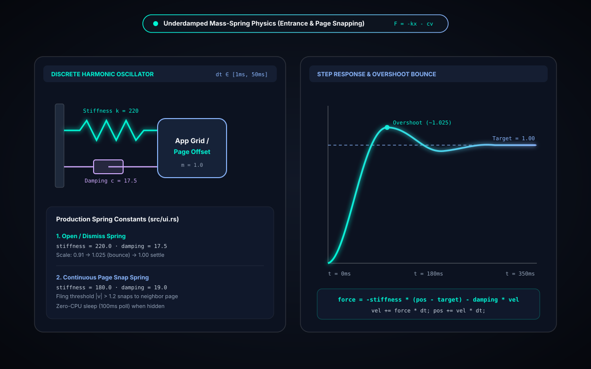

# Spring Physics & Animations



Winscroller 2d Appview integrates a discrete damped harmonic oscillator every frame (`dt ∈ [0.001s, 0.05s]`):

```rust
let force = -stiffness * (pos - target) - damping * vel;
vel += force * dt;
pos += vel * dt;
```

- **Open / Dismiss Spring**: `stiffness = 220.0`, `damping = 17.5`. Scales the app grid from `0.91 → 1.025 (bounce) → 1.00`.
- **Page Snapping Spring**: `stiffness = 180.0`, `damping = 19.0`. Smoothly glides `page_offset` into `target_page` after swipes, drags, or pagination pill clicks.
- **Zero Idle Overhead**: When hidden, the renderer sleeps at `100ms` intervals until woken by a gesture, hotkey, or tray click.
