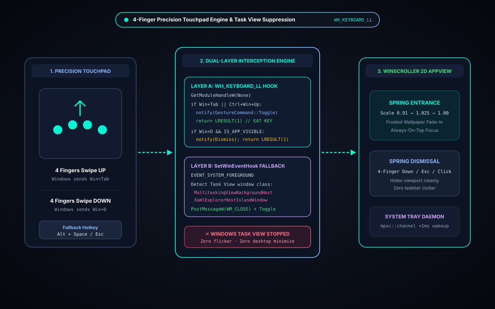

# Touchpad Gestures & Windows Task View Suppression

## Stopping Windows Task View on 4-Finger Swipe Up
Windows Precision Touchpads map 4-finger swipe up to Windows Task View (`Win + Tab`). Winscroller 2d Appview stops Task View using two coordinated hooks in `src/hotkey.rs`:

1. **`WH_KEYBOARD_LL` (with `GetModuleHandleW(None)`)**: Intercepts `Win + Tab` and `Ctrl + Win + Up`, triggers `GestureCommand::Toggle`, and returns `LRESULT(1)` to swallow the event before DWM sees it.
2. **`SetWinEventHook` (`EVENT_SYSTEM_FOREGROUND`..`EVENT_OBJECT_SHOW`)**: If Task View (`MultitaskingViewBackgroundHost` or `XamlExplorerHostIslandWindow`) is ever activated directly by a vendor driver, Winscroller closes it immediately (`WM_CLOSE` + `VK_ESCAPE`) and opens the overview.

## 4-Finger Swipe Down
Intercepts `Win + D` and `Ctrl + Win + Down` only while `IS_APP_VISIBLE` is `true`, preventing your open desktop windows from minimizing while Winscroller plays its spring dismissal animation.

## Two-Finger Horizontal Page Swipes
Two-finger left/right swipes continuously update `page_offset` via `MouseWheel` `delta.x` and `smooth_scroll_delta.x`. Fast flicks (`|velocity| > 1.2`) fling cleanly to the next or previous page.
